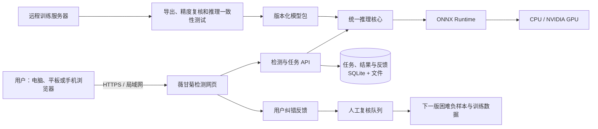

# 薇甘菊智能识别与检测系统方案 v1.0

日期：2026-08-04  
状态：实施基线  
适用阶段：地面 RGB 图像单类目标检测；无人机斑块分割暂不进入 v1

## 1. 系统目标

本项目不只交付一个训练权重，而是交付一套可供非研发人员使用的**薇甘菊识别与检测系统**：

- 用户在电脑、平板或手机浏览器中上传图片；
- 系统标出疑似薇甘菊区域，显示置信度和处理时间；
- 支持单图、批量图片和结果报告导出；
- 普通设备可用 CPU 运行，NVIDIA 设备可启用 GPU；
- 可部署在一台服务器上供多人访问，也可在没有外网的电脑上本地运行；
- 每个结果都能追溯到模型版本、数据版本和判定阈值，便于论文、专利和错误分析。

系统页面应使用“疑似薇甘菊区域”和“未检出”表述。“未检出”不等于确认不存在薇甘菊；检测框代表目标区域，不把缠绕株丛的框数解释为植株数量。

## 2. 推荐的总体方案

### 2.1 核心决策

| 决策 | v1 选择 | 原因 |
|---|---|---|
| 使用入口 | 浏览器网页 | 用户设备无需安装 Python 或训练环境，电脑、平板和手机均可访问 |
| 前端 | React + TypeScript + Vite | 适合实现图片对照、批量任务、图表和后续功能扩展 |
| 后端 | FastAPI | 与现有 Python 训练工程衔接直接，也可形成独立、可测试的推理接口 |
| 默认推理格式 | ONNX Runtime | 同一模型包可覆盖 CPU、CUDA 等不同执行设备 |
| v1 数据存储 | SQLite + 本地文件目录 | 无需额外数据库服务，适合单机和中小规模多人使用 |
| 交付方式 | CPU/GPU 两种 Docker 镜像 + Compose | 固定依赖，减少换设备后环境不一致的问题 |
| 训练与使用 | 完全分离 | 服务器负责训练和验收；用户端只加载冻结模型做推理 |
| 模型兼容 | 一个稳定的检测器接口 | 页面和接口不绑定某个 YOLO 版本，可替换为 RT-DETR、Faster R-CNN 等模型 |

v1 在代码中保持前端、接口和推理层的逻辑分离，但发布时将编译后的网页和后端放入**一个应用容器**。这样既便于维护，也让普通用户只需启动一个应用。

### 2.2 系统结构



训练服务器和在线推理服务不得共享同一个未受控的运行环境。若演示阶段临时共用现有服务器，应固定推理所用 GPU 或使用 CPU，并避免正式训练抢占推理资源。

## 3. 用户看到的页面

### 3.1 首页

- 简短说明系统能做什么、不能做什么；
- 显示当前模型版本、运行设备和服务状态；
- 提供示例图片，让第一次使用者可以立即体验；
- 明确支持的文件格式、隐私和数据保留规则。

### 3.2 单图识别

这是 v1 的主页面：

1. 拖入、选择或在移动设备上拍摄一张图片；
2. 自动纠正手机照片方向并执行检测；
3. 并排显示原图和标框结果；
4. 显示“检出疑似薇甘菊区域 / 未检出”、目标区域数、置信度和耗时；
5. 用户可调显示阈值，但页面同时保留模型推荐阈值；
6. 下载标注图、JSON 或 CSV 结果；
7. 对漏检、误检或正确结果提交反馈。

### 3.3 批量识别

- 上传多张图片或一个 ZIP 文件；
- 显示任务进度、成功数、失败数和剩余项目；
- 按“检出 / 未检出 / 需复核”筛选；
- 汇总图片数、疑似目标区域数、置信度分布和处理耗时；
- 下载标注图压缩包、逐图 CSV、完整 JSON 和汇总报告；
- 单张失败不导致整个批次中止，可重新处理失败项。

### 3.4 历史与分析

- 按日期、模型版本、设备、置信度和结果状态检索；
- 展示常见误报、漏检和低置信度图片；
- 比较两个模型版本在同一批图片上的差异；
- 研究模式下展示按日期、相机设备、目标大小等维度的统计；
- 普通用户不显示训练参数等复杂信息。

### 3.5 管理与复核

该页面只对管理员开放：

- 查看当前模型及历史模型；
- 上传候选模型包并运行自检；
- 切换模型前先验证格式、哈希、样例推理和阈值；
- 一键回退到上一稳定模型；
- 复核用户提交的误检、漏检和不确定反馈；
- 只有人工确认后的反馈才允许进入下一版数据，不能自动在线训练。

## 4. 算法与推理流程

### 4.1 识别定义

当前算法任务是地面近景图片中的单类目标检测：

- 输入：一张 RGB 图片；
- 输出：零个或多个 `mikania` 边界框、置信度和坐标；
- 图像级识别：存在至少一个高于冻结部署阈值的有效框时，标记为“检出疑似薇甘菊区域”；
- 目标计数：只统计检测区域，不声称等同于独立植株数。

### 4.2 标准推理链

1. 校验文件真实类型、大小和像素尺寸；
2. 根据 EXIF 纠正拍摄方向并转换为标准 RGB；
3. 按模型元数据执行 letterbox、缩放和归一化；
4. 运行冻结模型；
5. 使用模型包规定的后处理和部署阈值；
6. 将坐标映射回原图，生成标框图和结构化结果；
7. 记录模型、阈值、耗时和执行设备；
8. 按隐私策略保存或清理原图与结果。

不能把图像预处理、NMS、阈值等规则散落在网页代码中；它们属于推理核心，并随模型包版本化。用户调节的显示阈值只影响当前展示，正式导出的默认判定仍记录冻结阈值及用户实际采用的阈值。

### 4.3 模型选择

当前 YOLO26n/s 是工程基线，不预先指定为最终发布模型。最终模型应按实验方案，在完成标签质控、困难负样本确认和冻结测试后，从精度、误报、CPU 延迟、GPU 延迟和模型体积综合选择。

建议形成两个发布档位：

- `mikania-lite`：优先保证普通 CPU 设备可用；
- `mikania-accurate`：用于服务器或 GPU 设备，优先保证低误报和识别精度。

如果两个模型的验证收益不足以覆盖维护成本，v1 只发布一个默认模型。

## 5. 模型包与版本管理

每个可部署模型必须是一个不可变目录：

```text
model_store/
└── mikania-<model-version>/
    ├── model.onnx
    ├── metadata.json
    ├── labels.json
    ├── thresholds.json
    ├── model_card.md
    └── sha256sums.txt
```

`metadata.json` 至少包含：

- 模型 ID、语义版本和创建时间；
- 训练运行 ID、数据版本、划分版本和随机种子；
- 输入尺寸、色彩顺序、归一化和后处理规范；
- ONNX opset 与已验证运行设备；
- 内部测试、时间外测试、困难负样本测试指标；
- 推荐阈值及其选择规则；
- 已知局限、适用范围和许可证信息。

发布流程为：训练权重 → 导出 ONNX → 与原框架逐图一致性检查 → 固定测试集评估 → 性能测试 → 生成模型卡和哈希 → 标记候选版本 → 管理员批准 → 上线。模型文件不能用同名覆盖；切换失败时必须能回退。

## 6. 对外接口

| 接口 | 用途 |
|---|---|
| `GET /api/v1/health` | 检查应用、模型和执行设备是否正常 |
| `GET /api/v1/model` | 返回当前模型版本、阈值、能力和限制 |
| `POST /api/v1/predictions/image` | 单张图片同步检测 |
| `POST /api/v1/jobs` | 创建批量检测任务 |
| `GET /api/v1/jobs/{job_id}` | 查询批量任务进度和摘要 |
| `GET /api/v1/jobs/{job_id}/results` | 获取或导出结构化结果 |
| `POST /api/v1/feedback` | 提交误检、漏检或正确反馈 |

每个检测结果至少返回：

```json
{
  "request_id": "...",
  "model_version": "...",
  "recommended_threshold": 0.0,
  "applied_threshold": 0.0,
  "presence": "detected_or_not_detected",
  "detections": [
    {
      "label": "mikania",
      "confidence": 0.0,
      "box_xyxy_pixels": [0, 0, 0, 0]
    }
  ],
  "latency_ms": 0.0,
  "execution_provider": "CPU_or_CUDA"
}
```

接口版本和模型版本相互独立。更换模型不应迫使其他调用方修改接口；破坏性接口变更才升级 `/api/v2`。

## 7. 跨设备部署

### 7.1 推荐：中心服务器模式

应用部署在一台可访问的服务器上，其他人直接打开网址：

- 用户端零安装；
- 模型只维护一份，更新和回退最简单；
- 适合实验室、学校或单位局域网；
- 对公网开放时必须配置域名、HTTPS、访问控制、上传限额和备份。

现有训练服务器可用于内部演示，但正式长期服务应将训练任务和在线服务隔离，至少固定资源和独立容器；条件允许时使用独立推理主机。

### 7.2 离线电脑模式

交付 `mikania-app:cpu` 镜像和启动器：

- Windows、macOS、Linux 安装 Docker 后均可启动；
- 启动器自动检查端口、目录和服务状态，然后打开浏览器；
- 图片留在本机，适合无外网或数据敏感环境；
- 首次下载镜像后可离线使用。

### 7.3 NVIDIA GPU 模式

交付独立的 `mikania-app:gpu` 镜像：

- 用于支持的 Linux + NVIDIA 运行环境；
- 启动时验证 GPU 执行提供者，失败时给出清楚提示；
- 是否允许自动回退 CPU 由配置决定，不能静默改变性能模式。

### 7.4 后续可选模式

- PWA 安装到手机桌面，但推理仍可由中心服务器完成；
- 浏览器内 ONNX Runtime Web，用于小模型和真正无后端演示；
- Android/iOS 原生应用或边缘设备部署。

这些不是 v1 必需项。先验证网页、CPU/GPU 容器和真实用户流程，再决定是否投入移动端开发。

## 8. 隐私、安全与稳定性

- 本地离线模式不向外部服务上传图片；
- 中心服务器模式默认设置可配置的原图保留期限，过期自动清理；
- 导出图片默认移除 GPS 等敏感 EXIF；研究模式需要明确授权后才能保留拍摄日期和设备字段；
- 只接受允许的图片格式，并同时校验扩展名、文件签名和解码结果；
- 上传文件使用系统生成名称，禁止用户路径直接进入文件系统；
- 限制单文件大小、像素数、批量数量、并发任务和处理时长；
- 普通局域网演示可不设账户，跨单位或公网访问必须增加身份认证和权限；
- 日志只保存任务 ID、版本、耗时和错误摘要，不记录密码、令牌或不必要的原图信息；
- 应用提供健康检查、启动自检、异常重启和磁盘空间预警；
- 用户反馈进入隔离目录，经人工复核后再进入数据版本。

## 9. 许可证发布门

当前训练环境使用 Ultralytics YOLO 作为基线。根据 Ultralytics 当前官方许可说明，其 YOLO 代码和训练模型默认涉及 AGPL-3.0；如果整个系统完全按 AGPL-3.0 开源，可按相应义务发布。如果系统要闭源、作为商业服务、嵌入硬件或不公开完整工程，则需要在发布前取得适用的商业许可，或改用许可证满足项目要求的模型与训练实现。

因此推理层必须保持模型无关，且每个模型包必须记录许可证。许可证审查是对外发布和专利商业化前的强制门，不以导出 ONNX 的方式规避。具体对外方案应由项目权利人结合使用场景进行法律确认。

## 10. 工程目录建议

```text
Agricultural_Species_Identification/
├── apps/
│   └── web/                    # React 页面
├── services/
│   └── api/                    # FastAPI 路由与任务接口
├── src/
│   ├── mikania_data/           # 已有数据工具
│   ├── mikania_training/       # 已有训练工具
│   └── mikania_inference/      # 预处理、后处理、ONNX 推理与报告
├── model_store/                # 本地模型包；大权重不直接提交 Git
├── deploy/
│   ├── docker/
│   └── launchers/              # Windows/macOS/Linux 启动器
├── tests/
│   ├── inference/
│   ├── api/
│   └── system/
└── docs/
```

不在 v1 引入 Kubernetes、微服务集群、消息队列或 PostgreSQL。只有并发量、任务可靠性或多机构权限出现真实需求时再升级，避免为了“看起来完整”增加部署负担。

## 11. 实施阶段与验收

界面开发不必等待最终论文模型。M1–M4 可先使用已经完成管线验证的 S0 权重或后续单种子候选权重打通全流程，但页面必须标记为“开发预览模型”，不得展示为正式精度。数据质控和正式实验并行推进；M5 通过后再替换为冻结发布模型。

### M1：推理核心

- 定义模型包规范和统一结果格式；
- 将候选权重导出为 ONNX；
- 完成方向纠正、预处理、后处理、绘图和报告；
- 对同一冻结测试集比较原训练框架与 ONNX 结果；
- 保存精度差异、延迟、峰值内存和失败样例。

验收：同一模型的 ONNX 部署结果不出现实质性精度回退，所有差异都有记录；输入异常不会导致服务崩溃。

### M2：接口服务

- 完成健康、模型信息、单图、批量任务和反馈接口；
- 建立 SQLite 任务记录和可配置清理机制；
- 自动生成 API 文档和集成测试。

验收：单图与批量任务均能得到可追溯结果；重启后已完成任务记录仍可读取。

### M3：展示页面

- 完成首页、单图、批量、历史分析和管理员复核页面；
- 优先适配普通电脑，并保证手机浏览器可完成单图上传和查看；
- 加入示例图、进度、错误提示和下载。

验收：不了解 Python 的使用者仅凭页面提示可独立完成上传、识别和结果下载。

### M4：跨设备交付

- 构建 CPU 和 GPU 镜像；
- 提供一键启动、停止、升级、备份和自检；
- 在干净的 Windows/macOS/Linux CPU 环境和 Linux NVIDIA 环境测试；
- 记录每台参考设备的 P50/P95 延迟、吞吐量和内存。

验收：换一台没有项目源码的设备，也能按照一页说明启动系统；中心服务器部署后，局域网内手机和电脑可访问。

### M5：算法冻结与正式发布

- 完成 16 个超大框、12 张缺标图片和 123 张候选负样本的人工质控；
- 执行基线、困难负样本与三随机种子实验；
- 在未参与训练的固定测试集上冻结模型和推荐阈值；
- 完成模型卡、限制说明、许可证确认和回滚演练。

验收：满足实验方案预设的工程指标，或明确记录未达到的指标及错误分析；页面不得展示未经测试支持的精度宣传。

## 12. v1 范围控制

### v1 必须完成

- 地面近景薇甘菊单类检测；
- 单图和批量网页识别；
- 标框、置信度、耗时和结果导出；
- 模型版本、阈值和结果追溯；
- CPU/GPU 容器、中心服务器与离线运行；
- 用户反馈和人工复核入口；
- 测试、模型卡、隐私说明和部署文档。

### v1 暂不包含

- 无人机冠层覆盖分割；
- 自动判断防治方案或生物学风险等级；
- 把目标框数当作植株计数；
- 未经人工审核的自动增量训练；
- 原生手机应用、边缘摄像头和 Kubernetes 集群；
- 面向公网的多租户计费平台。

## 13. 与论文和专利的衔接

系统不是论文算法创新的替代品，而是实验成果的可复现载体：

- 每次预测记录模型、数据、阈值和执行环境，形成论文证据链；
- 反馈页面沉淀经人工确认的困难负样本，用于 Mikania-HN 方法迭代；
- 历史分析页自动生成误报、漏检、低置信度和同图模型对照素材；
- 专利重点应放在有实验支持的困难负样本挖掘、误报控制或其他具体技术方法，普通上传识别页面本身通常不构成算法创新；
- 对外演示版本、论文冻结模型和未来产品版本分别编号，避免实验结果与持续更新的在线模型混淆。

## 14. 参考技术依据

- [FastAPI：容器化部署](https://fastapi.tiangolo.com/deployment/docker/)
- [Docker Compose：单一配置管理和启动应用栈](https://docs.docker.com/compose/)
- [ONNX Runtime：跨平台推理](https://onnxruntime.ai/docs/)
- [ONNX Runtime Execution Providers](https://onnxruntime.ai/docs/execution-providers/)
- [React：组件化网页界面](https://react.dev/)
- [Vite：React/TypeScript 工程与浏览器支持](https://vite.dev/guide/)
- [Ultralytics 官方许可说明](https://www.ultralytics.com/license)
